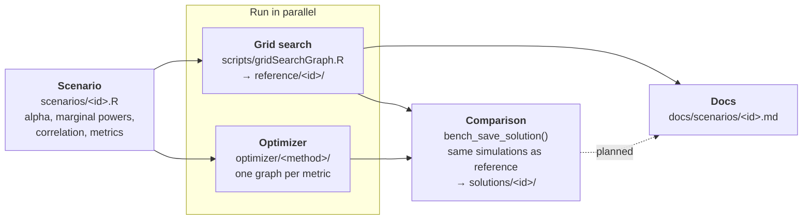

# graphicalMCP-bench

Benchmark cases for comparing optimizers for the graphical approach in multiple
testing, built on the R package
[`graphicalMCP`](https://cran.r-project.org/package=graphicalMCP).

Each case is a **scenario**: k hypotheses with alpha, marginal powers,
correlation and metrics. A brute-force grid search over the graphs `(w, G)`
gives the scenario's **reference solution**, the best graph for each metric.
Optimizer solutions are scored against it. The reference is optimal only on the
grid and up to Monte-Carlo error, so an optimizer that searches continuously
may beat it.

The results of all scenarios are in the [scenario index](docs/README.md).

## How it works



The grid search and the optimizers start from the same scenario and run
independently. The comparison scores each optimizer's graphs on the same
simulations as the reference. The scenario pages show the reference results;
adding the optimizer solutions to them is planned.

## Requirements

R with the `graphicalMCP` and `parallelly` packages. On a cluster, the packages
must be installed in a library that every compute node can see.

## Getting started

### Smoke test

The smoke test runs the start-up checks and estimates the time and memory of the
full run from a small sample of the grid. It writes nothing.

```sh
# Local
Rscript scripts/gridSearchGraph.R scenario=example_k3 smoke=TRUE

# Single Slurm job
sbatch --mem=2000 --cpus-per-task=4 --time=00:20:00 \
  --wrap="Rscript scripts/gridSearchGraph.R scenario=example_k3 smoke=TRUE"

# Single LSF job
bsub -n 4 -R "rusage[mem=2000]" -W 0:20 \
  "Rscript scripts/gridSearchGraph.R scenario=example_k3 smoke=TRUE"
```

**Expected outcome:** the `[verify ...]` checks pass, followed by the grid size
and the estimated CPU time, memory and wall time, both for a single job and for
a job array. Use these numbers to size the cluster jobs.

### Job array test

This runs the example as 5 shards plus a merge job:

```sh
N_SHARDS=5 CORES=2 bash cluster/slurm/submit_array.sh scenario=example_k3   # Slurm
N_SHARDS=5 CORES=2 bash cluster/lsf/submit_array.sh scenario=example_k3     # LSF
```

**Expected outcome:** five shard files appear in `results/example_k3/shards/`.
The merge job then writes `reference/example_k3/` and
`docs/scenarios/example_k3.md`, the same result as a single run. This overwrites
the committed example; restore it with
`git checkout -- reference/example_k3 docs`.

## Repository layout

| Folder | Contents |
|--------|----------|
| [`scenarios/`](scenarios/README.md) | Scenario definitions and the template for new ones |
| [`scripts/`](scripts/README.md) | Entry points: grid search and docs rendering |
| [`cluster/`](cluster/README.md) | Slurm and LSF submission scripts |
| [`optimizer/`](optimizer/README.md) | Optimizer methods and how their solutions are scored |
| `R/` | Grid search, rejection engine, reporting and solution scoring |
| `reference/` | Committed reference results, one folder per scenario |
| `solutions/` | Committed optimizer solutions, one folder per scenario |
| [`docs/`](docs/README.md) | Generated scenario pages (do not edit by hand) |
| `results/` | Ad-hoc runs and job-array shards (local, not committed) |

Each linked folder has a README with the details. To add a scenario or an
optimizer solution, see [CONTRIBUTING.md](CONTRIBUTING.md).
